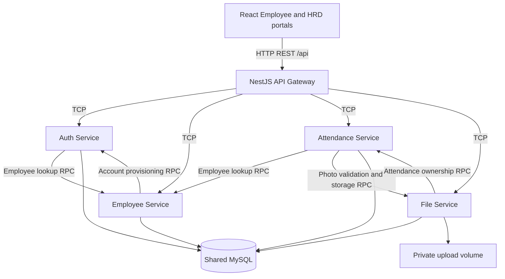

# Dexa WFH Attendance

Work-from-home attendance for two roles: **Employee** submits a photo-backed check-in and views personal history; **HRD** manages employees and monitors attendance without editing or deleting it.

Built with React, Vite, TypeScript, NestJS, Prisma, and MySQL. An HTTP gateway fronts four NestJS TCP microservices. This implements the scope in the [technical blueprint](dexa-wfh-technical-implementation-blueprint.md), with the implementation decisions and limitations below.

> Verified: repeated workspace builds, 34 automated tests, 36 local live integration groups, 35 development-mode API groups through Vite, and 13 local Chrome browser groups including 375px layouts. Full and production npm audits reported zero vulnerabilities. Docker images built, Compose reached healthy startup, explicit seed exited 0, and deployed Nginx passed 35 API groups, 13 Chrome 157 browser groups and four Docker outage/persistence checks. Browser GPS used the actual browser geolocation API with known-coordinate overrides and injected failure callbacks—not physical GPS coordinates or remote HTTPS. See [validation details](docs/IMPLEMENTATION.md) and the [testing guide](docs/TESTING.md).

## Scope and rules

- Employee: login, dashboard/profile, check-in with a required JPG/PNG photo and coordinates, private attendance history.
- HRD: dashboard, searchable/paginated employee management, creation, profile updates, password resets and deactivation; searchable/date-filtered attendance and photo detail.
- **HRD attendance access is read-only.** There are no public attendance update/delete endpoints. Internal saga compensation is not an HRD editing capability.
- One attendance per employee per **Asia/Jakarta calendar day**, enforced by a database unique constraint, including concurrent submissions.
- The server sets attendance time; browser-supplied employee IDs, statuses, dates, and timestamps are not check-in inputs.
- GPS is requested **once per explicit check-in attempt** using `getCurrentPosition`, not `watchPosition`, polling, or background/live tracking. Location failure blocks submission with guidance.
- No check-out, facial recognition, payroll, shift scheduling, approval workflow, or email notifications.

## Architecture



| Component | Responsibility | Default port |
| --- | --- | --- |
| Web | React portals; `/api` proxy through Vite locally or Nginx in Docker | 5173 local / 8080 Docker |
| API Gateway | REST, DTO validation, authentication/roles, bounded multipart parsing, response/error mapping, Swagger | 3000 HTTP |
| Auth Service | `users`, bcrypt, JWT issuance/verification; refreshes role and active employee state on authenticated requests | 4001 TCP |
| Employee Service | `employees`, profile/search/status and account provisioning through Auth RPC | 4002 TCP |
| Attendance Service | `attendances`, Jakarta-day uniqueness, GPS validation, check-in orchestration and read models | 4003 TCP |
| File Service | `attendance_photos`, image validation, private disk storage and authorized reads | 4004 TCP |
| MySQL | Shared development/technical-test database | 3306 |

These are separate processes with **logical ownership**, not fully isolated databases. Services use scalar IDs and owner RPCs rather than Prisma cross-owner relations or cross-service SQL joins. They currently share a Prisma schema/client and database credentials; table ownership is a code convention, not a database permission boundary. The bootstrap seed is an explicit cross-owner exception that provisions Employee and Auth records in transactions. TCP services must remain on a trusted private network: internal calls do not have service-to-service authentication or TLS.

### Multipart and file ownership

Multer's Nest `FileInterceptor` is an HTTP/Express facility, not a multipart parser for Nest's TCP transport. The gateway therefore parses `multipart/form-data` with **memory storage**, limited to one photo, three fields, four parts, and **5 MiB (5,242,880 bytes)** per photo. It performs an early MIME/extension check and forwards a base64 payload through Attendance to File over TCP. File Service owns authoritative MIME/extension/signature/size validation, generated names, metadata, filesystem writes, and cleanup. No gateway disk storage or public `/uploads` static route is used.

This is a deliberate transport adaptation of the blueprint, not streaming uploads. Base64 expands payloads by approximately one third; buffering/serialization creates additional copies, and per-request limits do not cap total concurrent memory usage. Nginx allows 6 MiB request bodies to accommodate multipart overhead. Add edge concurrency/rate limits for a public deployment.

### Check-in saga and failure semantics

1. Authenticate the caller and require `EMPLOYEE`.
2. Attendance captures server time/Jakarta date and rejects an existing attendance before file validation/storage.
3. Validate coordinate ranges and active employee state; ask File to validate the photo without storing it.
4. Insert attendance. The unique `(employee_id, attendance_date)` constraint arbitrates a duplicate race before either request stores a photo.
5. Ask File to validate again, verify attendance existence over TCP, write a UUID-named file exclusively, and insert photo metadata.
6. Return the attendance enriched with employee and photo metadata.

This is **not an atomic distributed transaction**. File attempts cleanup after a failed write/metadata operation; a confirmed cleaned-up storage failure is reported as 507. Attendance then asks File to remove any related photos before deleting its own row. If cleanup fails, it preserves the row and logs its ID for reconciliation.

For ambiguous 500/503/504 storage outcomes, Attendance preserves the row rather than racing a late successful File operation with deletion. A lost response or later enrichment failure can therefore return an error **after attendance has committed**. Refresh history before retrying; a retry can correctly return 409. Crashes can leave attendance without a photo, metadata without bytes, or orphan bytes. There is no durable saga state, outbox, automatic reconciliation worker, or request idempotency key beyond daily uniqueness. Operator review is required; never promise all-or-nothing behavior. See [safe failure testing](docs/TESTING.md#safe-failure-injection-and-reconciliation).

## Repository layout

```text
apps/
  api-gateway/src/        HTTP controllers, DTOs, guards, Swagger, error envelopes
  auth-service/src/       Login, JWT, account/password ownership
  employee-service/src/   Employee management and account provisioning saga
  attendance-service/src/ Check-in, query validation, attendance orchestration
  file-service/src/       Photo validation, private storage and access control
  web/src/                Pages, components, API/auth/query and GPS utilities
packages/shared/src/     TCP clients/bootstrap, Prisma provider, errors, Jakarta dates
prisma/
  schema.prisma           Shared schema with logical owner annotations
  migrations/             Versioned MySQL migrations
  seed.ts                 Environment-supplied HRD and Employee bootstrap accounts
scripts/                  Safe env setup, dev supervisor, DB preparation and test runners
infrastructure/nginx.conf SPA serving and /api proxy configuration
Dockerfile                dependencies/build/production-dependencies/runtime/web targets
docker-compose.yml        MySQL, migration/seed jobs, gateway, services, web
docs/                     Implementation status and testing/acceptance instructions
```

### Database schema

| Prisma model / SQL table | Owner | Important fields and constraints |
| --- | --- | --- |
| `Employee` / `employees` | Employee | Unique `employeeNumber`, unique `email`; `fullName`, optional department/position, `ACTIVE`/`INACTIVE`, created/updated timestamps |
| `User` / `users` | Auth | Unique scalar `employeeId`; `passwordHash`, `EMPLOYEE`/`HRD` role, created timestamp |
| `Attendance` / `attendances` | Attendance | Scalar `employeeId`; date-only `attendanceDate`, `checkInAt`, `PRESENT`, latitude/longitude `Decimal(10,7)`, optional accuracy, created timestamp; unique employee/day and date/time index |
| `AttendancePhoto` / `attendance_photos` | File | Indexed scalar `attendanceId`; generated `fileName`, internal `filePath`, MIME, size, created timestamp |

Cross-owner IDs have **no foreign keys or cascading deletes**. Application RPCs check existence; recovery must account for partial cross-service changes. The schema permits nullable coordinates for storage compatibility, but new check-ins require both latitude and longitude. `checkInAt` is a UTC instant; `attendanceDate` represents the Jakarta calendar day encoded at UTC midnight for a MySQL `DATE`. UI formatting uses Jakarta time (WIB). `filePath` is not returned as public photo metadata.

## Requirements and environment

- Node.js matching **`^22.12.0 || ^24.0.0 || >=26.0.0`** and npm with workspace support. Node 22.12+ within 22.x or 24.x is recommended; Node 23.x and 25.x are not allowed by the declared engine range. Use the committed lockfile with `npm ci`.
- MySQL **8.4** is the Compose reference database.
- Docker Engine/Desktop and Docker Compose v2 for container setup or Docker-backed integration testing.
- A current browser with location services and permissions. Geolocation needs **HTTPS or localhost**. Plain HTTP on a LAN IP is not equivalent to localhost; use trusted HTTPS when testing on a phone/remote host.
- File Service needs a writable private upload directory. Back up database and uploaded bytes together.

**Recommended first step: `npm run setup:env`**, before installing dependencies. This dependency-free Node script works through npm without `node_modules`. It generates random MySQL, JWT and seed-password secrets and creates root `.env` using exclusive `wx` creation (mode `0600` where supported); it never overwrites an existing file. It prints only the seed emails (`hrd@example.com`, `employee@example.com`), not passwords. Inspect your private `.env` locally for generated passwords and keep it secret. Alternatively, copy `.env.example` and supply every placeholder yourself. The template contains no usable credentials. Do not commit `.env` or real secrets.

| Variable | Requirement / meaning |
| --- | --- |
| `DATABASE_URL` | Required for Prisma/local services: MySQL URL using your supplied user/password, host, port, and database. Local host is normally `127.0.0.1`; Compose overrides it to `mysql`. Percent-encode reserved characters in URL credentials. |
| `MYSQL_DATABASE`, `MYSQL_USER` | Compose database/user names; both default to `dexa` (names, not passwords). Keep local `DATABASE_URL` consistent. |
| `MYSQL_PASSWORD`, `MYSQL_ROOT_PASSWORD` | Required Compose secrets, generated by setup or supplied yourself; no password defaults. Compose interpolates the application password into its URL, so use URL-safe values or account for encoding. |
| `MYSQL_PORT` | Compose's published host MySQL port, default 3306; container MySQL remains 3306. If changed for host-run apps, also update the port in `DATABASE_URL`. |
| `INTEGRATION_MYSQL_PORT` | Test-runner-only override of the port in `DATABASE_URL`; does not change Compose's published port or ordinary `npm run dev`. Browser runner defaults this override to 3307; set it explicitly to your actual test port. |
| `JWT_SECRET` | Required; at least 32 characters after trimming. Supply a cryptographically random secret, not a placeholder. |
| `JWT_EXPIRES_IN` | Optional, default `8h`; positive seconds or duration such as `30m`, `8h`, `1d`. |
| `SEED_HRD_EMAIL`, `SEED_HRD_PASSWORD` | Both required to run the seed. You choose the HRD login. |
| `SEED_EMPLOYEE_EMAIL`, `SEED_EMPLOYEE_PASSWORD` | Both required to run the seed. You choose the Employee login. |
| `PORT` | Gateway HTTP port, default 3000. Vite/Nginx proxy targets assume 3000 unless you also change their configuration. |
| `CORS_ORIGIN` | Comma-separated permitted origins; default `http://localhost:5173`. Same-origin web proxies normally avoid browser CORS issues. |
| `AUTH_HOST`, `EMPLOYEE_HOST`, `ATTENDANCE_HOST`, `FILE_HOST` | TCP client destinations; default `127.0.0.1` locally. Compose overrides to service DNS names. These are not bind-address settings. |
| `AUTH_PORT`, `EMPLOYEE_PORT`, `ATTENDANCE_PORT`, `FILE_PORT` | TCP ports; defaults 4001–4004 respectively. |
| `UPLOAD_DIR` | Private File storage path; default `uploads`, Compose `/app/uploads` backed by a named volume. |
| `WEB_PORT` | Docker web host port, default 8080. |

**There is no built-in password.** Setup supplies example email names with freshly random passwords; these are not fixed login credentials. Seeding requires all four `SEED_*` values. Emails must be valid and distinct; passwords must be at least **12 characters** and at most **72 UTF-8 bytes**. The seed hashes with bcrypt cost 12. It provisions `SEED-HRD` and `SEED-EMPLOYEE` employee numbers, not hardcoded login emails/passwords. Re-running reconciles these accounts by employee number and resets their configured email/password/role; do not treat it as harmless sample-data insertion in a live database.

## Local development with npm

Run commands at the repository root. Generate a private environment first, then install from the lockfile and start MySQL (or use your own MySQL instance):

```sh
npm run setup:env
npm ci
docker compose up -d mysql
npm run prisma:generate
npm run db:migrate
npm run db:seed
npm run dev
```

Setup generates `DATABASE_URL` with host port **3306**. If that port is occupied, set `MYSQL_PORT=3307` and change **only the port** in your private `DATABASE_URL` to 3307 before the commands above. Keep the generated password intact. Changing `MYSQL_PORT` alone does not retarget host-run Prisma/services. For a one-off Compose invocation in a POSIX shell, `MYSQL_PORT=3307 docker compose up -d mysql` changes the published port, but you must still align host `DATABASE_URL` (or use the test-only override below).

`db:migrate` applies checked-in migrations using `prisma migrate deploy`; it does not create migration files. `db:dev` uses `prisma migrate dev` for intentional schema development and may need a shadow database/extra permissions. Do not use it as production deployment or reset a populated database to fix startup.

`npm run dev` runs `scripts/dev.mjs`, which loads the root `.env`, generates Prisma, and starts all six app workspaces with the inherited environment. **Run it via npm**, not `node scripts/dev.mjs`: the supervisor requires npm's `npm_execpath`. It does not start MySQL, apply migrations, or seed. Shell environment values can override dotenv values; do not inherit Docker-only service hostnames or a `DATABASE_URL` pointing to host `mysql` when running on the host. If starting individual workspaces instead, explicitly supply the same environment and working-directory assumptions; do not assume every runner finds the root `.env` automatically. The supervisor stops siblings when a child exits and handles process-tree shutdown on Windows. Backend source workspaces run `node --watch --require ts-node/register/transpile-only src/main.ts`, preserving TypeScript decorator metadata required by Nest dependency injection. Do not substitute an esbuild/`tsx` backend dev runner that omits that metadata; `tsx` remains appropriate for the seed and applicable test tooling.

Open:

- Web: `http://localhost:5173`
- API health: `http://localhost:3000/api/health`
- Swagger: `http://localhost:3000/api/docs`

Vite proxies `/api` to `http://localhost:3000`; the frontend uses relative `/api` URLs, not a required frontend API secret/environment variable. Sign in with the values **you supplied** to the seed. To compile workspaces, use `npm run build`.

## Docker Compose

Generate root `.env` if you have not already, then build/start and explicitly seed:

```sh
npm run setup:env
docker compose up --build -d --wait
docker compose --profile seed run --rm seed
docker compose ps
docker compose logs --tail=100 migrate api-gateway auth-service employee-service attendance-service file-service
```

MySQL must become healthy before the one-shot migration job runs. Backends wait for migration success. The optional `seed` profile is **not** run automatically by ordinary `up`; run it explicitly. Backend runtime uses a non-root Node user; migrations/seed use the tooling/build image with Prisma CLI and `tsx`.

- Web: `http://localhost:8080` (or configured `WEB_PORT`). Nginx serves the SPA and proxies `/api`.
- Gateway/Swagger: `http://localhost:3000/api/docs`; health: `/api/health`.
- MySQL publishes only to host loopback `127.0.0.1:${MYSQL_PORT:-3306}`; the internal MySQL service always uses 3306.
- TCP service ports are not published to the host by Compose.
- `mysql-data` and `uploads` named volumes persist database and photos across container replacement.
- Native and Docker deployments use different filesystem stores by default. Do not share one database between them without also migrating/synchronizing the photo bytes. The local supervisor anchors relative `UPLOAD_DIR` at the repository root; individual workspace processes should receive an absolute path.
- `docker compose down` stops/removes containers while retaining named volumes. **`down -v` destroys database and photos**; never use it for routine recovery.

The Compose gateway healthcheck performs HTTP `GET /api/health`, which checks all four TCP services and their database connectivity—not merely a listening socket. The web container waits for a healthy gateway. The backend, tooling and web images built successfully; `MYSQL_PORT=3307 docker compose up -d --no-build --wait` exited 0. Explicit Docker seed also exited 0 with `MYSQL_PORT=3307 docker compose --profile seed run --rm --no-deps seed` after migration/startup. Deployed Nginx passed 35 external API groups and 13 Chrome 157 browser groups. Four opt-in Docker resilience checks passed, covering File/MySQL outages, reconnection, and retained data/photo bytes across restart/container replacement. Nginx hides upstream `X-Content-Type-Options` and `Referrer-Policy` before emitting them once at the edge, avoiding duplicate security-header values. TLS termination and production ingress are not included; add them before remote GPS use or transmitting passwords/tokens off localhost.

## HTTP API

All business endpoints use `/api`. Authenticate with `Authorization: Bearer <your-access-token>`. JSON successes are `{ "data": ... }`; errors contain `statusCode`, `message` (string or array), `path`, and UTC `timestamp`. Photo downloads are raw bytes, not a JSON envelope. Swagger documents DTOs and bearer authentication at `/api/docs`.

| Method | Endpoint (after `/api`) | Access | Purpose |
| --- | --- | --- | --- |
| GET | `/health` | Public | Gateway and four service/database health results |
| POST | `/auth/login` | Public, process-local rate limit | JSON `{email,password}`; returns access token and identity/profile |
| GET | `/auth/me` | Authenticated | Verified current identity/profile |
| GET | `/employees` | HRD | Paginated employee search |
| POST | `/employees` | HRD | Create employee and Employee-role login |
| GET | `/employees/:id` | HRD | Employee detail |
| PATCH | `/employees/:id` | HRD | Update supplied profile/password/status fields |
| GET | `/attendances/me` | Employee | Own paginated attendance only |
| POST | `/attendances/check-in` | Employee | Photo and one-time coordinates |
| GET | `/attendances` | HRD | Read-only monitoring |
| GET | `/attendances/:id` | HRD | Read-only attendance detail |
| GET | `/files/:id` | HRD or owning Employee | Private photo bytes by **photo ID**, not attendance ID |

Lists accept `page` (default 1), `pageSize` (default 20, max 100), and `search` (employee name/number). Attendance lists also accept a real calendar `date` in `YYYY-MM-DD` Jakarta-day format. List data is `{items,total,page,pageSize}`. Employee creation requires `employeeNumber`, `fullName`, `email`, and `password`; `department` and `position` are optional. Update supports those fields plus `status: ACTIVE | INACTIVE`. Normal employee password input has a minimum of 8 characters and is bounded for bcrypt; seed requirements are deliberately stronger. Do not send a role field to create an HRD account through employee management.

Check-in is `multipart/form-data` with exactly one `photo`, required finite `latitude` (-90 to 90) and `longitude` (-180 to 180), and optional nonnegative finite `gpsAccuracy` in meters. The browser omits unavailable accuracy. Do not set the multipart boundary manually. There is no standalone upload endpoint: photo creation is part of check-in. Unknown DTO fields are rejected, not accepted as an alternate identity/time source.

Expected failure categories include 400 invalid input/image, 401 missing/expired/invalid credentials or inactive identity, 403 disallowed role/ownership, 404 missing resource, 409 duplicate employee values/daily attendance, 413 oversized photo, 429 login throttling, 503 unavailable dependency, 504 RPC timeout, and 507 confirmed cleaned-up storage failure. See saga semantics before interpreting a failed submission as uncommitted.

## Security and known limitations

- Password hashes use bcrypt cost 12. JWT uses HS256, issuer/audience checks and expiry (default eight hours), with no fallback signing secret. Verification reloads account role and employee activity rather than trusting stale token role claims.
- Browser tokens are stored in `sessionStorage`, sent as bearer headers, and cleared on logout/401; query caches are cleared on logout. This is not an HttpOnly-cookie design. XSS can expose tokens; no refresh-token flow, server logout revocation, or automatic token invalidation on password reset is implemented.
- Photo reads require ownership or HRD authorization and return `Cache-Control: private, no-store`. UUID names, exclusive creation, restrictive file mode where supported, bounded input and safe generated paths reduce upload risks. Signature checks are **not** full image decoding, antivirus scanning, EXIF removal, or proof of a genuine/current selfie.
- GPS is device/browser-reported and spoofable; it is not a geofence, location attestation, or employee surveillance system. Only a check-in snapshot is captured. Define consent, access, retention and deletion policies before production use of sensitive location/photo data.
- Login protection is bounded, in-memory and per gateway process, not distributed rate limiting. Reverse-proxy client-IP trust and edge limits need deployment review.
- Private TCP traffic is unauthenticated/unencrypted and listeners bind all interfaces. Do not expose ports 4001–4004; use network controls and service authentication/TLS for stronger isolation.
- Shared database credentials do not enforce ownership. No durable distributed transaction/reconciliation, comprehensive audit trail, retention jobs, cloud/object storage, malware scanner, or production backup/HA solution is included.
- Employee/account creation has compensating cleanup; profile and password updates are separate owner operations and may partially succeed if Auth is unavailable.
- Dashboards summarize recorded check-ins and employee totals, not a scheduling/absence/payroll calculation. Only `PRESENT` attendance is modeled.

## Validation

```sh
npm run build
npm test
npm audit
npm audit --omit=dev
npm run test:integration
npm run test:browser
```

Reported results:

| Check | Verified result |
| --- | --- |
| All-workspace `npm run build` | Passed twice and passed again in final verification |
| `npm test` | 34 passed: Attendance 12, File 4, frontend 18; repeated pass |
| npm audit, full and production dependencies | Zero reported vulnerabilities; final root audit repeated successfully |
| Local live HTTP/TCP/MySQL integration | 36 groups passed, including File outage and restoration |
| Source dev services + API through Vite | 35 integration groups passed |
| Chrome browser suite | 13 groups passed, including Employee/HRD layouts at 375px after containing absolute screen-reader labels within `.data-table` |
| Fresh MySQL migration and environment-driven seed | Passed; repeated migration/seed was idempotent |
| Docker backend/tooling/web images and healthy Compose startup | Passed; explicit Docker seed exited 0 |
| External API through deployed Nginx | 35 groups passed |
| External browser through deployed Nginx | 13 groups passed in Chrome 157 |
| Docker resilience | Four checks passed: File outage, photo survival after File container replacement, MySQL outage, recovery/data/photo persistence |

`npm run test:integration` prepares the database with migration deployment and seed, then runs the live harness. It **resets designated seed credentials and creates test records without deleting them**; use a disposable database. Build first. `npm run test:browser` needs a migrated/seeded database and a browser: it uses installed Chrome when available, otherwise `BROWSER_EXECUTABLE` or Playwright Chromium (`npx playwright install chromium`). Set `INTEGRATION_MYSQL_PORT` explicitly (3306 or 3307) for browser tests; its current default is 3307.

Port 3306 was occupied in the verified local environment, so test runners used 3307:

```sh
MYSQL_PORT=3307 docker compose up -d mysql
INTEGRATION_MYSQL_PORT=3307 npm run test:integration
INTEGRATION_MYSQL_PORT=3307 npm run test:browser
INTEGRATION_MYSQL_PORT=3307 npm exec --offline --call="node scripts/dev-smoke.mjs"
```

For an already migrated, healthy disposable Docker stack, the verified deployed checks were:

```sh
MYSQL_PORT=3307 docker compose --profile seed run --rm --no-deps seed
INTEGRATION_BASE_URL=http://localhost:8080/api node scripts/integration.mjs
BROWSER_BASE_URL=http://localhost:8080 npm run test:browser
RUN_DISPOSABLE_OUTAGE_TESTS=true MYSQL_PORT=3307 node scripts/docker-resilience.mjs
```

The resilience script deliberately stops/restarts this project's File and MySQL services and force-recreates File; use it **only on a disposable local Compose project** after integration has created a photo-backed attendance. It retains records/volumes rather than erasing the database. A dependency outage may return 503 **or 504** because TCP timeout is a legitimate failure mode. Port 3306 in the verified environment belongs to another project; do not stop it to free the port.

These inline assignments use POSIX-shell syntax; on other shells set the equivalent process environment. `INTEGRATION_MYSQL_PORT` changes the test process URL only; ordinary local development still needs a matching `DATABASE_URL`.

If the editor shows stale generated Prisma types while CLI TypeScript builds pass, run `npm run prisma:generate` and restart the editor's TypeScript language server; do not alter a correct schema merely to clear cached diagnostics.

Chrome exercised real rendered pages and the actual browser geolocation API with a known-coordinate override; denied/unavailable/timeout paths used injected callbacks. **Real hardware GPS and remote trusted HTTPS were not verified.** Manual checklists remain unverified unless separately recorded. See [docs/TESTING.md](docs/TESTING.md) for runner modes, safe failure injection and remaining acceptance work.
